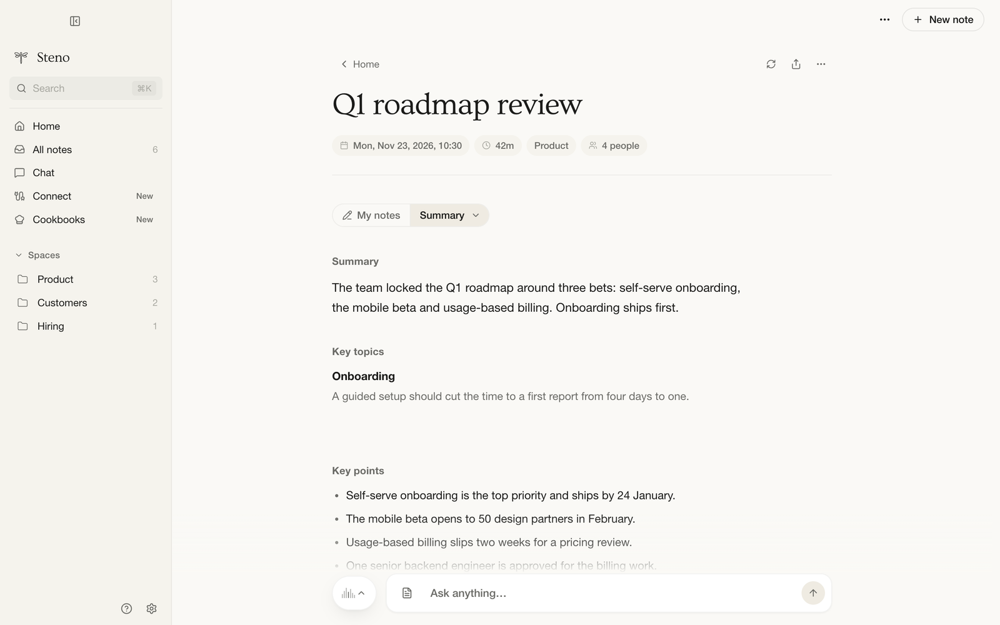

<div align="center">
  

  # StenographAI

  *Your private stenographer*
</div>

<p align="center">
  <a href="https://github.com/stenolabs/stenoai/actions/workflows/build-release.yml"></a>
  <a href="https://github.com/stenolabs/stenoai/releases"></a>
  <a href="https://discord.gg/DZ6vcQnxxu"></a>
  <a href="LICENSE"></a>
  
  
  <a href="#sponsors"></a>
</p>

<p align="center">StenographAI is a privacy-first AI notepad for confidential conversations. Record, summarise, and query meetings with local AI by default; optional external providers can be enabled if you choose.</p>

<p align="center"><sub>Trusted by teams at <b>AWS</b>, <b>Deliveroo</b>, <b>Tesco</b>, <b>Hashicorp</b>, <b>Rutgers</b> & <b>European Union</b>.</sub></p>

<div align="center">
  <picture>
    <source srcset="website/public/demo.gif" type="image/gif">
    
  </picture>

  <br>

  [](https://x.com/ruzin_saleem)
</div>

<p align="center"><sub>Sponsored by <b>Gitlab Founder's Open Core Ventures</b>.</sub></p>

<p align="center"><sub><i>Disclaimer: This is an independent open-source project for meeting-notes productivity and is not affiliated with, endorsed by, or associated with any similarly named company.</i></sub></p>

## Sponsors

### Recall.ai - API for desktop recording

If you're looking for a hosted desktop recording API, consider checking out [Recall.ai](https://www.recall.ai/product/desktop-recording-sdk?utm_source=github&utm_medium=sponsorship&utm_campaign=ruzin-stenoai), an API that records Zoom, Google Meet, Microsoft Teams, in-person meetings, and more.

## 📢 What's New

- **2026-11-26** ✅ Approve an app once: Choose Always allow on an action card and that app's follow-ups run without asking. Turn it off in Settings → Connectors.
- **2026-11-24** 🔌 Connect your AI apps: Claude, Cursor, Claude Code and Codex can read your meetings through Steno's read-only MCP server. Set it up on the new Connect page.
- **2026-11-24** ⚡ Actions: Connect Linear, Notion, Jira or any MCP server, and Steno suggests follow-ups after each note that run only when you approve them.
- **2026-11-24** ⏱️ Instant transcripts: With Parakeet, your transcript and a first summary are ready the moment you press Stop, then refine in the background.

## Features

- **Privacy-first**: local AI processes your recordings, transcripts, and summaries on your device. External AI providers are optional.
- **Live speaker labels** — Real-time on-screen text as you speak via Parakeet TDT v3 on Apple Silicon (MLX). Granola-style chat-bubble view with `[You]` vs `[Others]` attribution live during the recording.
- **Individual speakers (macOS)** — Once the recording stops, Steno separates the voices sharing each channel, so the saved transcript reads `Speaker 2` / `Speaker 3` rather than one merged `[Others]`. Sortformer remains the default; Nemotron 3 can be selected under Settings → AI after its models download. Name a speaker once and Steno can suggest them in later meetings — that part is off by default, and the voice profiles never leave your Mac.
- **Auto start/stop meetings** — Steno notices when a meeting starts and offers to take notes, then offers to summarise when it ends. Granola-style frictionless capture.
- **Auto-record detected meetings** — Turn it on under Settings → Preferences, and Steno starts recording a detected meeting without waiting for a tap. It needs Auto-detected meetings on, and a Recording started notification offers Stop. Off by default. Remember to obtain the consent of all participants when necessary.
- **Identify call participants (macOS)** — Put the other party of a phone or FaceTime call into a note's Participants, by Contacts name, through the free [iMCP](https://imcp.app) app. Caller names reach the AI model, cloud ones included; numbers stay on your Mac. Off by default.
- **Open meetings** — With a calendar connected, Steno can open a meeting's Meet, Zoom or Teams link shortly before it starts, or ask first. Off by default, under Settings → Preferences.
- **System audio capture** — Record both sides of virtual meetings. Native Core Audio Tap on macOS 14.4+, Windows loopback capture, and PipeWire capture on Linux, with selectable microphone input. A recording can use system audio alone when no microphone is present.
- **Instant transcripts** — With Parakeet, Stop saves the live transcript at once, labelled You / Others, and writes a first summary from it. Steno then refines the transcript, speaker labels and notes in the background.
- **Recording that coexists** — A compact transcription pill docks beside the app instead of taking over; Stop lands you on the note instantly and you can resume recording into an existing note (it appends and re-generates on demand).
- **Global record shortcut** — Start or stop recording from anywhere with `⌃⌥R` (`Ctrl+Alt+R` on Windows). The default changed from `⌘⇧R`, which clashed with refresh. Pick your own combination in Settings → Preferences, or turn it off. On macOS, power users can additionally bind any key of their own via the `stenoai://record/start` / `record/stop` deep links (Shortcuts app).
- **Always-editable notes** — Click any part of a note, including a cookbook report, and type; changes save automatically. Jot your own notes in the **My notes** tab while you record. Regenerating keeps your edited version for recovery.
- **Ask your meetings** — Ask general questions anytime, including while recording. Attach This meeting, All notes, a space, or Shared notes as optional context, or choose No meeting context. Answers stream in with a trace of the steps chat took, and conversations stay with the note when recording stops.
- **Actions in chat** — With a tool-capable model, ask chat to create a Linear issue or a Notion page, and approve each change before it runs. Chat tells you when the selected model can't use your connected apps.
- **Charts in chat** — Ask for a bar, line, area, pie, donut, scatter, radar or table chart from numbers in your notes. View its data, or copy it as an image or CSV.
- **Connect** — Give the Claude desktop app, Cursor, Claude Code and Codex read-only access to your meetings through the bundled Steno MCP server or the Steno skill. Limit what they can see in Settings → Connectors. See the [Connect guide](docs/connect/overview.mdx).
- **Actions** — Connect Linear, Notion, Jira and Confluence, and Steno suggests follow-ups after each note for you to approve. Email drafts open in your own mail app, and custom MCP servers (n8n, Zapier, Make, or a command on this computer) work too. See [Actions](docs/connect/actions.mdx).
- **Meeting packages (macOS)** — Import and export `.stenomeeting` packages containing notes and transcripts. Include audio only when you choose; supported recordings are compressed for export while originals stay unchanged.
- **Multi-language (25 live, 99 total)** — Parakeet covers 25 European languages with live transcription; Whisper handles 99 languages including Chinese, Japanese, Arabic, and Hindi post-stop.
- **Markdown ownership** — Summaries and transcripts save as clean Markdown you can edit, search, or sync to an Obsidian vault from Connect.
- **Cookbooks and recipes** — Cookbooks (formerly report templates) set the format of a note; a note can hold several reports, and flat YAML frontmatter appears in a collapsible Properties panel. Recipes are saved chat prompts you run by typing `/` in Chat. Both have built-in options and your own, in the Cookbooks sidebar page.
- **Share and export** — Use a saved note's Share menu to copy or export notes and transcripts. On macOS, send a note through the system share sheet.
- **Bring your own cloud model** — Optional OpenRouter, OpenAI, Anthropic, AWS Bedrock (Claude — including application inference profile ARNs for governed AWS environments), or any OpenAI-compatible endpoint — including a [LiteLLM](docs/getting-started/litellm.mdx) proxy or vLLM server your organisation runs — for users who prefer a hosted LLM. Setup guides you through getting an OpenRouter, OpenAI or Anthropic key and tests it before saving.
- **Optional cloud transcription** — Choose an OpenAI-compatible transcription endpoint in Settings → AI. Enabling it requires confirmation because recording audio is sent to that provider.
- **Organisation AI** — On managed deployments, sign in to your org's Steno adapter and AI routes through it automatically — no local API key, no per-user setup.

## Coming from Granola?

If you already use Claude Code / Cowork with a connected Granola MCP, the
[`granola-to-steno`](skills/granola-to-steno/README.md) skill syncs your Granola
meeting notes (titles, dates, participants, summaries, and transcripts) into
StenographAI's file-based store. It is idempotent and re-runnable, so you can backfill
your history once and keep it in sync on a schedule. This is an agent skill you
drop into your skills folder and invoke conversationally ("sync Granola to
StenographAI"), not an in-app feature. See
[`skills/granola-to-steno/README.md`](skills/granola-to-steno/README.md) for
setup and limitations.

## Use your notes from an agent (`/steno`)

The [`steno`](skills/steno/README.md) skill makes an AI agent aware of your local
StenographAI notes. Run `/steno` (or just mention your meetings) and it pulls in the
relevant notes and acts on them — answer a question across meetings, recap your
week, extract action items, or use the meetings as source material to draft a
spec, PRD, or follow-up. It can also **guide you through setting up a cloud model**
(`/steno setup`) — OpenAI, Anthropic, AWS Bedrock, or a custom endpoint.

It's read-only over your notes (never modifies them), needs only Python 3.8+ (no
dependencies), and is a drop-in agent skill — copy `skills/steno/` into your
skills folder. See [`skills/steno/README.md`](skills/steno/README.md).

## macOS Shortcuts (Optional)

<details>
<summary>Expand setup and calendar automation guide</summary>

StenographAI supports Apple Shortcuts via deep links using the `stenoai://` URL scheme.

- Start recording: `stenoai://record/start?name=Daily%20Standup`
- Stop recording: `stenoai://record/stop`

### How to set it up

1. Open the **Shortcuts** app on macOS.
2. Create a new shortcut (for example: "Start StenographAI Recording").
3. Add the **Open URLs** action.
4. Use one of the URLs above.
5. (Optional) Add a keyboard shortcut from the shortcut settings.

### Calendar event naming (optional)

If you want calendar-based names, resolve the event title in your Shortcut workflow and pass it as the `name` query value in the start URL.

Example:

`stenoai://record/start?name=Weekly%20Product%20Sync`

### Calendar event start automation (via Rules bridge)

macOS Shortcuts **cannot natively trigger** exactly at Calendar event start.  
To run this automatically on event timing, a third-party automation app is required.

This addon uses:

- **Apple Shortcuts**: builds the `stenoai://record/start?...` action.
- **Rules – Calendar Automation**: watches Calendar events and triggers the shortcut.

#### Architecture overview

1. Rules App monitors upcoming Calendar events.
2. Rules checks the event note/body for a marker keyword (for example `stenoai`).
3. If matched, Rules runs a Shortcut.
4. The Shortcut gets the next event title and opens:
   - `stenoai://record/start?name={calendar_event_title}`
5. StenographAI receives the URL and starts recording with that name.

#### Step-by-step setup

1. Install **Rules – Calendar Automation** on macOS.
2. Create a Shortcut in Apple Shortcuts (example name: `StenographAI Start From Calendar Event`).
3. In that Shortcut, add actions in this order:
   - `Find Calendar Events` (limit to `1`, sorted by start date ascending, upcoming only)
   - Extract the event title from the found event
   - `URL Encode` the title
   - `Open URLs` with:
     - `stenoai://record/start?name=<encoded title>`
4. Open Rules and create a calendar-trigger rule:
   - Source: your target calendar(s)
   - Trigger window: event start (or preferred offset)
   - Condition: event note contains `stenoai`
   - Action: run Shortcut `StenographAI Start From Calendar`
5. In your Calendar event notes, add the word `stenoai` for meetings that should auto-start recording.
6. Test with a near-future event:
   - create event with `stenoai` in notes,
   - wait for trigger,
   - confirm StenographAI starts and uses the event title as session name.

#### Notes

- Without Rules (or another automation bridge), this cannot be fully event-driven from Calendar start time.
- Keep using regular manual shortcuts (`Open URLs`) for non-automated scenarios.

Have questions or suggestions? [Join our Discord](https://discord.gg/DZ6vcQnxxu) to chat with the community.
</details>

## Models & Performance

**Transcription Models:**
- `Parakeet TDT v3` (572 MB): Highest quality, supports live transcription, 25 European languages (English, Spanish, French, German, Italian, Portuguese, Dutch, Russian, Polish, Czech, and 15 others). Apple Silicon only via MLX. **(default on fresh installs)**
- `Whisper Large V3 Turbo` (1.6 GB): Best-accuracy Whisper engine for the languages Parakeet can't speak (Chinese, Japanese, Korean, Arabic, Hindi, Hebrew, and 93 others). Post-stop only.
- `ivrit.ai Hebrew Turbo` (1.6 GB, optional): A Hebrew fine-tune of Whisper Large V3 Turbo by [ivrit.ai](https://huggingface.co/ivrit-ai). Download it in Settings → AI → Transcription; the Whisper engine then uses it for recordings pinned to Hebrew, and for recordings auto-detected as Hebrew with a detection probability of at least 0.5 (weaker detections stay on the main model).

**Summarization Models** (Ollama):
- `gemma4:e2b-it-qat` (4.3GB): Lightest Gemma 4, quantization-aware, with a real 128K context **(default)**
- `gemma4:e4b-it-qat` (6.1GB): Quantization-aware E4B — higher quality than E2B at a modest footprint
- `qwen3.5:9b` (6.6GB): Excellent at structured output and action items
- `gemma4:12b-it-qat` (7.2GB): Gemma 4 (quantization-aware) with a 256K context — best for long meetings
- `gpt-oss:20b` (14GB): OpenAI open-weight model with reasoning capabilities

## Future Roadmap

### Enhanced Features
- Windows: GA hardening (alpha already ships on Windows 10/11 x64)

## Installation

Download the latest release (**Apple Silicon Mac, macOS 14.4 or later**):

- [Apple Silicon (M1-M5)](https://github.com/stenolabs/stenoai/releases/latest/download/stenoAI-macos-arm64.dmg)

> **Intel Mac users**: v0.4.0 is Apple Silicon only. Stay on [v0.3.8](https://github.com/stenolabs/stenoai/releases/tag/v0.3.8) — the last release supporting Intel Macs. Auto-update on existing Intel installs will not push v0.4.0 to those machines.

### Installing on macOS

1. **Download and open the DMG file**
2. **Drag the app to Applications**
3. **When you first launch the app**, macOS may show a security warning
4. **To fix this warning:**
   - Go to **System Settings > Privacy & Security** and click **"Open Anyway"**

   **Alternatively:**
   - Right-click Steno in Applications and select **"Open"**
   - Or run in Terminal: `xattr -cr /Applications/Steno.app`
5. **The app will work normally on subsequent launches**

You can run it locally as well (see below) if you don't want to install a DMG.

### Windows (alpha)

Windows 10/11 (x64) is supported in **alpha**, with the full pipeline verified working: record → live Parakeet transcription → batch transcript → Ollama summary, **including system-audio loopback capture with `[You]`/`[Others]` diarisation**.

**Install:** download **`stenoAI-windows-x64.exe`** from the [latest release](https://github.com/stenolabs/stenoai/releases/latest) and run it — it installs per-user (no admin needed) and creates Start-menu/desktop shortcuts. On first launch, Windows SmartScreen warns because the alpha is unsigned — click **More info → Run anyway**. The first-run setup wizard then downloads the transcription model (~670 MB) and the default summarisation model, Gemma 4 E2B (~4.3 GB).

> Before the first tagged Windows release lands, grab the installer from the [Windows build workflow](https://github.com/stenolabs/stenoai/actions/workflows/build-windows.yml): sign in to GitHub, open the latest green run, download the `stenoai-windows` artifact, and run the `.exe` inside.

Known alpha limitations:

- **Unsigned** — SmartScreen warns on first launch; we'll code-sign before 1.0.
- **CPU-only summarisation** — the bundled Ollama runs on CPU (the NVIDIA GPU libraries are excluded to keep the download small); a separate GPU build is a follow-up. Transcription is CPU on every platform regardless.
- **Auto-update** is wired (NSIS + `latest.yml`) but updates are unsigned until code signing is in place.
- **Transcription** runs through `onnx-asr` (ONNX Runtime) instead of MLX, with the same Parakeet model and behaviour as macOS. Whisper is also available as an engine option.

### Linux (Debian/Ubuntu, alpha)

Verified on Ubuntu 26.04 LTS (GNOME/Wayland, PipeWire), including system-audio loopback capture with `[You]`/`[Others]` diarisation.

**Install (`.deb`, recommended):** download [`stenoAI-linux-amd64.deb`](https://github.com/stenolabs/stenoai/releases/latest/download/stenoAI-linux-amd64.deb) from the [latest release](https://github.com/stenolabs/stenoai/releases/latest) and install it with `sudo apt install ./stenoAI-linux-amd64.deb` — apt pulls in the required system libraries automatically.

**AppImage:** download [`stenoAI-linux-x86_64.AppImage`](https://github.com/stenolabs/stenoai/releases/latest/download/stenoAI-linux-x86_64.AppImage), `chmod +x` it, and run it. An AppImage carries no package metadata, so **you must install PortAudio yourself** or the setup check fails with `OSError: PortAudio library not found`:

```bash
sudo apt install libportaudio2
```

Known alpha limitations:

- **Unsigned**, same as the Windows alpha.
- **GPU support for summaries** — Linux packages retain Ollama's CUDA and Vulkan backends; acceleration depends on your GPU and drivers. Transcription uses `onnx-asr` on CPU. A separately installed Ollama can also be used through Settings → AI → Private Server.
- **System audio requires PipeWire** (Ubuntu's default since 22.10). The toggle reports unsupported on a PulseAudio-only or headless install, and recording falls back to mic-only.
- **No speaker diarization sidecar** — per-channel `[You]`/`[Others]` labelling works, but the acoustic multi-speaker split is macOS-only.
- **No auto-update.** `.deb` installs update by downloading a new package; AppImage self-update is a follow-up.

Issues + feedback welcome on the GitHub issues tracker.

## Local Development/Use Locally

### Prerequisites
- Python 3.9+
- Node.js 18+

### Setup
```bash
git clone https://github.com/stenolabs/stenoai.git
cd stenoai

# Backend setup
python3 -m venv venv
source venv/bin/activate
pip install -r requirements.txt

# Download bundled binaries (Ollama, ffmpeg)
./scripts/download-ollama.sh

# Build the Python backend
pip install pyinstaller
pyinstaller stenoai.spec --noconfirm

# Frontend
cd app
npm install
npm start
```

Note: Ollama and ffmpeg are bundled - no system installation needed. The setup wizard in the app will download the required AI models automatically.

### Build
```bash
cd app
npm run build
```

## Project Structure

```
stenoai/
├── app/                  # Electron desktop app
├── src/                  # Python backend
├── website/              # Marketing site
├── recordings/           # Audio files
├── transcripts/          # Text output
└── output/              # Summaries
```

## Troubleshooting

### Debug Logs

**Setup wizard debug console:** during first-time setup, expand the debug console panel to see real-time logs of model downloads and service startup.

**Terminal logging (recommended for runtime issues):** launch the app from a terminal to stream all logs (Python subprocess output, Whisper transcription, Ollama API traffic, error stack traces):
```bash
/Applications/Steno.app/Contents/MacOS/Steno
```

**System Console:**
```bash
# View recent StenographAI-related logs
log show --last 10m --predicate 'process CONTAINS "Steno" OR eventMessage CONTAINS "ollama"' --info

# Monitor live logs
log stream --predicate 'eventMessage CONTAINS "ollama" OR process CONTAINS "Steno"' --level info
```

### Common Issues

- **Update didn't install**: Auto-updates are applied on next quit. Quit via the **Steno → Quit** menu (not just closing the window), then reopen.
- **No system audio / no `[Others]` speaker labels**: On macOS, allow Steno to record system audio in **System Settings → Privacy & Security → Screen & System Audio Recording**. Screen Recording access is not required.
- **`stenoai://` deep link doesn't start recording**: Make sure StenographAI has launched at least once after install so the URL scheme is registered. If it still fails, check the terminal log for `Protocol handler registration` output.
- **Recording stops early**: Check microphone permission, System Audio Recording permission (if recording system audio), and available disk space.
- **"Processing failed"**: Usually an Ollama service or model issue — check the terminal logs.
- **Empty transcripts**: Whisper couldn't detect speech — verify audio input levels.
- **Slow processing**: Normal for longer recordings; Ollama is CPU-intensive. If summaries are unusually slow, switch to a lighter model in Settings → AI (Gemma 4 E2B is the lightest/fastest).

### Logs Location
- **User Data**: `~/Library/Application Support/stenoai/`
- **Recordings**: `~/Library/Application Support/stenoai/recordings/`
- **Transcripts**: `~/Library/Application Support/stenoai/transcripts/`
- **Summaries**: `~/Library/Application Support/stenoai/output/`

## License

This project is licensed under the [MIT License](LICENSE).
